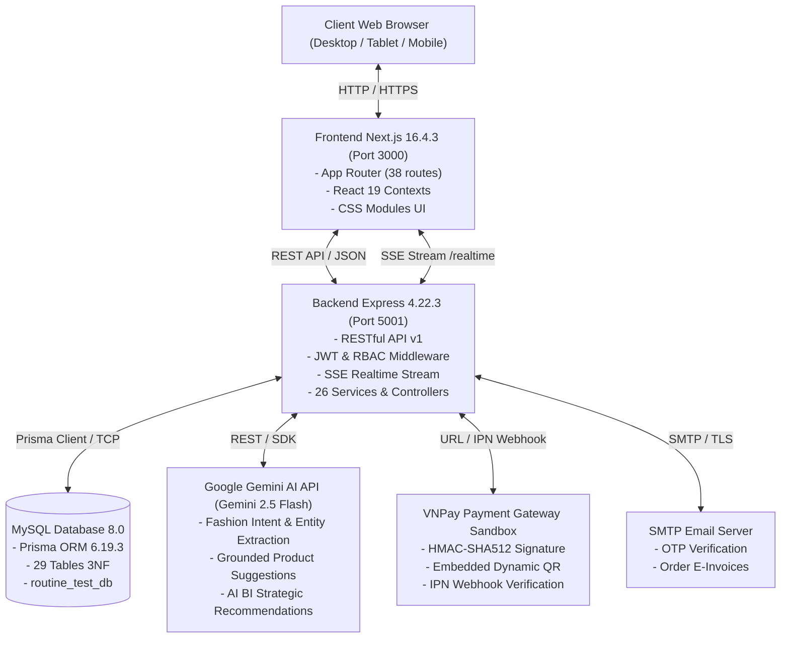
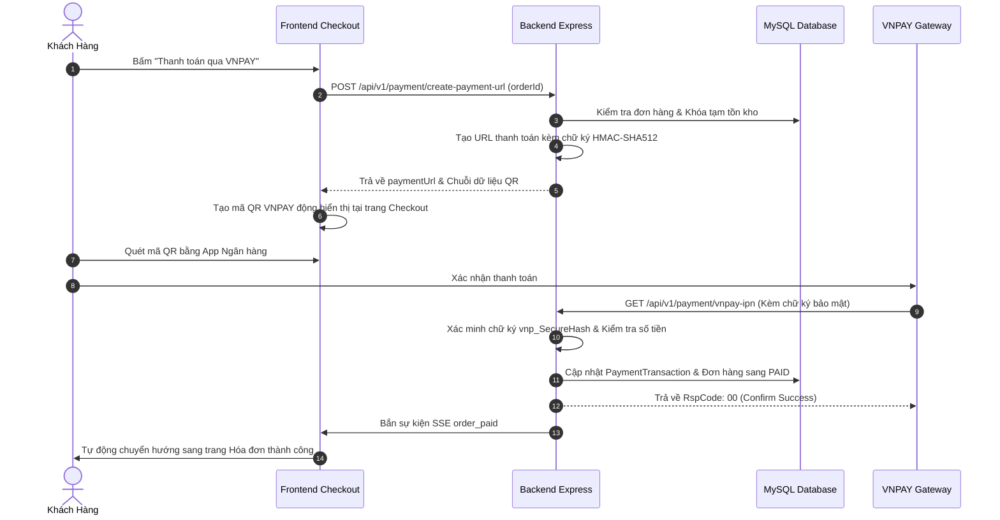
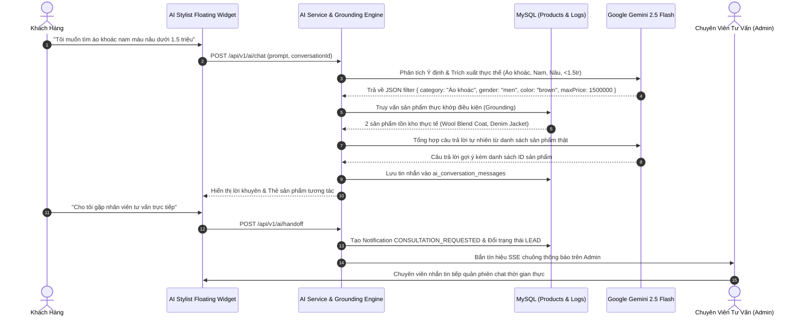

# KIẾN TRÚC TỔNG THỂ HỆ THỐNG ROUTINE E-COMMERCE PLATFORM
## SƠ ĐỒ KHỐI, LUỒNG DỮ LIỆU & TƯƠNG TÁC THÀNH PHẦN

---

## 1. SƠ ĐỒ KIẾN TRÚC TỔNG THỂ (C4 MODEL - SYSTEM CONTEXT)

---

## 2. LUỒNG DỮ LIỆU THANH TOÁN VNPAY EMBEDDED QR

---

## 3. LUỒNG TƯƠNG TÁC AI STYLIST & CHUYỂN GIAO LEAD (HANDOFF)
